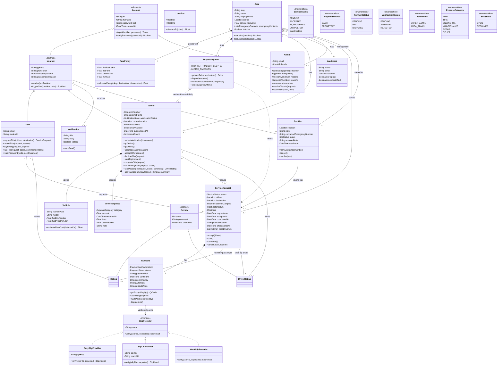

# Class Diagram — KU VIN

แผนภาพคลาสเชิงวัตถุ (design model) ของระบบเรียกวิน KU VIN สำหรับวิชา OOP
ออกแบบจากโครงสร้างข้อมูลใน `apps/api/prisma/schema.prisma` และพฤติกรรมใน `apps/api/src/services/`
โดยจัดเป็นคลาสที่มีทั้งข้อมูลและเมธอดของตัวเอง ใช้ inheritance, interface และ composition ตามหลัก OOP

## หลัก OOP ที่ใช้ในแผนภาพ

| หลัก | ตรงไหนในแผนภาพ |
|---|---|
| Inheritance | `Account` → `Member` / `Admin`, `Member` → `User` / `Driver`, `Review` → `Rating` / `DriverRating` |
| Abstraction | `Account`, `Member`, `Review` เป็น abstract class ไม่สร้าง object ตรง ๆ |
| Interface + Polymorphism | `SlipProvider` มี 3 implementation เลือกตอนรันตาม `SLIP_PROVIDER` และ `Payment` เรียก `verify()` โดยไม่ต้องรู้ว่าเป็นเจ้าไหน |
| Encapsulation | attribute เป็น `-` private / `#` protected ส่วน `passwordHash` เข้าถึงผ่าน `verifyPassword()` เท่านั้น |
| Composition | `Driver` *— `Vehicle`, `DriverExpense` · `Area` *— `FarePolicy`, `DispatchQueue` · `ServiceRequest` *— `Payment` |
| Aggregation | `Area` o— `Driver`, `Landmark` · `DispatchQueue` o— `Driver` (คนขับออกจากคิวได้แต่ยังอยู่ในระบบ) |
| Static method | `Area.findForPoint()` (ขีดเส้นใต้) หาพื้นที่จากพิกัดจุดรับ |

## ความสัมพันธ์กับโค้ดจริง

แผนภาพนี้เป็น design model โค้ดจริงเขียนด้วย JavaScript แบบ service function + Prisma จึงต่างจากแผนภาพในบางจุด

| ในแผนภาพ | ในโค้ด |
|---|---|
| `Account`, `Member` | ฟิลด์ที่ซ้ำกันใน model `User`, `Driver`, `Admin` (`fullName`, `passwordHash`, `isSuspended` ฯลฯ) |
| `Member` ที่รับ `Notification` / กด `SosAlert` | `recipientType` + `recipientId` และ `actorType` + `actorId` (enum `NotificationRecipient` = USER/DRIVER) |
| `Vehicle` | ฟิลด์ `licensePlate`, `vehicleModel`, `fuelKmPerLiter`, `fuelPricePerLiter` ใน `Driver` + `finance.service.js` |
| `FarePolicy` | ฟิลด์ `flatFare`, `ratePerKm`, `minFare`, `flatRadiusKm` ใน `Area` + `estimateFare()` |
| `DispatchQueue` | `queue.service.js` (`getNextDriverInQueue`, `dispatchRequest`, `handleDriverResponse`, `sweepExpiredOffers`) |
| `Payment` | ฟิลด์ `payment*` ใน `ServiceRequest` + `payment.service.js` |
| `SlipProvider` และ 3 คลาสลูก | `services/slip/` — object ที่มี `name` และ `verify()` เลือกใน `slip/index.js` |
| `Location` | คู่ `lat`/`lng` ที่ใช้ทุก model |
| `Review` | `Rating` กับ `DriverRating` มีฟิลด์ `score`, `comment`, `createdAt` เหมือนกัน |
